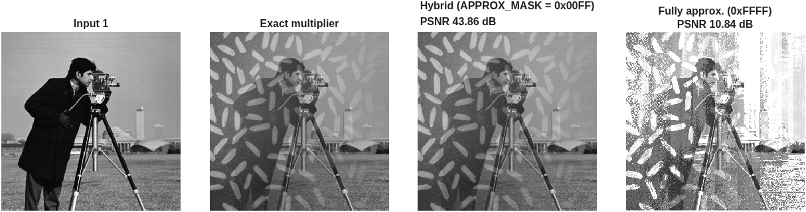

# ⚡ Design and Functional Verification of an Approximate 8-Bit Wallace Tree Multiplier

[](https://github.com/BavanPrabahar/Approximate-8bit-Multiplier/actions/workflows/ci.yml)
[](rtl/)
[](tb/)
[](synth/)
[](#4-fpga-timing-quartus-prime-lite)
[](matlab/)

> Implementation and exhaustive functional verification of an **approximate 8-bit Wallace Tree Multiplier** using gate-level logic approximation (OR gate substitution for XOR) and approximate 4:2 compressors. The amount of approximation is **configurable per output column**, from fully exact to fully approximate, so accuracy can be traded against power for error-tolerant applications in **multimedia processing, computer vision, and machine learning acceleration**.

---

## 📌 Executive Summary

Modern multimedia and deep learning workloads exhibit intrinsic error resilience: slight numerical inaccuracies in pixel arithmetic or neural weights produce virtually imperceptible perceptual degradation while offering substantial savings in power, silicon area, and delay.

In digital arithmetic, multiplication is among the most power- and delay-intensive operations. This project implements an **Approximate 8-Bit Multiplier** based on the Wallace tree reduction architecture. By substituting complex, high-delay XOR gates with simpler OR gates in half adders and full adders, we reduce transistor counts and switching power.

### 🌟 Key Highlights
* **Exhaustively verified:** every one of the 65,536 input pairs is simulated; the RTL matches a bit-accurate Python model exactly, and the same tree built from exact adders matches `a*b` exactly. Runs in CI on every push.
* **Configurable approximation (`APPROX_MASK`):** choose per column whether adders are approximate. Approximating only the 8 low columns gives **MRED 2.87 %** and **43.9 dB PSNR** in image blending, with an estimated **7.7 % lower dynamic power**.
* **Gate-Level Optimization:** Replaced power-hungry XOR gates (requiring up to 8–12 CMOS transistors) with compact OR gates (6 CMOS transistors): 110 → 48 XOR gates in the fully approximate design.
* **4:2 Compressor Architecture:** 4×4 multiplier reduces partial products with a chain of approximate 4:2 compressors.
* **FPGA timing:** the original Quartus Prime run measured **17.51 ns → 13.24 ns** critical path on Cyclone II (see the [note on these numbers](#4-fpga-timing-quartus-prime-lite)).

---

## 🔬 Theoretical Background & Gate-Level Comparison

In CMOS logic design, XOR gates are significantly slower and consume more static and dynamic power than primitive AND and OR gates due to deeper internal transistor stacks and higher parasitic capacitance.

### SPICE Normalized Relative Gate Comparison
| Gate | Relative Propagation Delay | Relative Power Consumption | Typical Transistor Count (CMOS) |
| :---: | :---: | :---: | :---: |
| **AND** | **0.58** | **0.42** | 6 |
| **OR** | **0.79** | **0.40** | 6 |
| **XOR** | **1.00** *(Reference)* | **1.00** *(Reference)* | 8 – 12 |

> **Design Principle:** Substituting XOR gates with OR gates eliminates deep transistor trees, directly improving dynamic switching power and the delay of every sum output.

---

## 📐 Circuit Architectures & Approximations

### 1. Approximate Half Adder (`haa`)
* **Exact Half Adder:**
  $$\text{Sum} = A \oplus B, \quad \text{Carry} = A \cdot B$$
* **Approximate Half Adder (`haa`):**
  $$\text{Sum} = A + B \quad (\text{OR gate}), \quad \text{Carry} = A \cdot B$$
* *Truth Table:*
  | A | B | Exact Sum | Exact Carry | Approx Sum | Approx Carry | Error? |
  | :-: | :-: | :-: | :-: | :-: | :-: | :-: |
  | 0 | 0 | 0 | 0 | 0 | 0 | No |
  | 0 | 1 | 1 | 0 | 1 | 0 | No |
  | 1 | 0 | 1 | 0 | 1 | 0 | No |
  | 1 | 1 | 0 | 1 | **1** | 1 | **Yes (1 of 4 cases)** |

### 2. Approximate Full Adder (`faa`)
* **Approximate Full Adder (`faa`):**
  $$\text{Sum} = (A \oplus B) + C_{\text{in}} \quad (\text{OR substitution on 2nd stage})$$
  $$C_{\text{out}} = (A \cdot B) + (B \cdot C_{\text{in}}) + (C_{\text{in}} \cdot A) \quad (\text{Exact Majority})$$
* The sum is wrong only when exactly one of $A, B$ is 1 and $C_{\text{in}} = 1$ (**2 of 8 cases**, always reading 1 instead of 0).

Both cells take a parameter `APPROX` (default 1). `APPROX = 0` turns them into exact adders. The value is a constant, so synthesis keeps only the selected gate and adds no multiplexer.

### 3. Approximate 4:2 Compressor
Compresses 4 partial product inputs ($x_1, x_2, x_3, x_4$) and carry-in ($C_{\text{in}}$) into Sum, Carry, and $C_{\text{out}}$ using a two-stage cascade of approximate adders. $C_{\text{out}}$ depends only on $x_1..x_3$, so chaining $C_{\text{out}}$ of column *i* into $C_{\text{in}}$ of column *i+1* does not ripple.

---

## 🏗️ 8-Bit Multiplier Structural Architecture (Wallace Tree)

The 8-bit multiplier generates an $8 \times 8$ matrix of partial products ($a_i \cdot b_j$) and compresses them through a 5-stage Wallace tree reduction network:

```
[ Inputs: A[7:0], B[7:0] ]
          │
          ▼
   Stage 1: Partial Product Generation (64 AND gates) + Initial Reduction (haa, faa)
          │
          ▼
   Stage 2: Column Reduction using haa and faa
          │
          ▼
   Stage 3: Secondary Wallace Tree Reduction
          │
          ▼
   Stage 4: Intermediate Sum and Carry Vector Condensation
          │
          ▼
   Stage 5: Final Vector Addition (haa13, faa43-faa51)
          │
          ▼
   [ Product Output: Z[15:0] ]
```

### Configurable approximation depth: `APPROX_MASK`

Every adder instance in [`rtl/mul_app.v`](rtl/mul_app.v) is tagged with its output column, e.g. `faa #(APPROX_MASK[4]) fa3(...)` sits in column 4 (weight $2^4$). Bit *i* of the 16-bit `APPROX_MASK` parameter makes the adders of column *i* approximate (1) or exact (0):

| `APPROX_MASK` | Meaning |
| :-: | :-- |
| `16'hFFFF` *(default)* | Every adder approximate: the original design |
| `16'h00FF` | Approximate in the 8 low-order columns only (**recommended hybrid**) |
| `16'h0000` | Every adder exact: same tree, used as the fair exact baseline ([`mul_exact_wallace.v`](rtl/mul_exact_wallace.v)) |

```verilog
mul_app #(.APPROX_MASK(16'h00FF)) u_mul (.a(a), .b(b), .z(z));
```

Errors in low columns are worth little; errors in high columns are worth up to $2^{15}$. Keeping the high-order columns exact is what makes the approximation usable.

---

## 📊 Experimental Results & Functional Verification

### 1. Exhaustive functional verification

The testbenches in [`tb/`](tb/) simulate **all 65,536** (8×8) and **all 256** (4×4) input pairs and are self-checking:

1. **Wiring check:** the same tree built from exact adders must equal `a*b` for every input. This proves the reduction network is wired correctly, independently of the approximation.
2. **Model check:** the approximate RTL must match the bit-accurate Python model ([`sim/verify_multiplier.py`](sim/verify_multiplier.py)) for every input.
3. **Synthesis check:** the gate netlist from Yosys is re-simulated on all inputs and must match the model too ([`synth/report.py`](synth/report.py)).

#### 8x8 Multiplier (`mul_app`, default `APPROX_MASK = 16'hFFFF`):
| A × B | Exact | Approx | Error |
| :-: | :-: | :-: | :-: |
| 132 × 231 | 30,492 | **31,132** | +640 (+2.10 %) |
| 255 × 255 | 65,025 | **65,535** | +510 (+0.78 %) |
| 128 × 128 | 16,384 | **16,384** | 0 *(Exact Match)* |
| 16 × 8 | 128 | **128** | 0 *(Exact Match)* |

#### 4x4 Multiplier (`mul_app_4x4`, default `APPROX_MASK = 8'hFF`):
| A × B | Exact | Approx | Error |
| :-: | :-: | :-: | :-: |
| 8 × 4 | 32 | **32** | 0 *(Exact Match)* |
| 10 × 4 | 40 | **40** | 0 *(Exact Match)* |
| 10 × 10 | 100 | **116** | +16 |
| 15 × 15 | 225 | **255** | +30 |

### 2. Error metrics (all 65,536 inputs)

Standard approximate-computing metrics: error rate (ER), mean error distance (MED), normalised MED (NMED = MED / 255²), mean relative error distance (MRED), worst-case error (WCE) and mean signed error (bias).

| Configuration | `APPROX_MASK` | ER (%) | MED | NMED | MRED (%) | WCE | Bias |
| :-- | :-: | --: | --: | --: | --: | --: | --: |
| Exact Wallace tree | `0x0000` | 0.00 | 0 | 0 | 0.000 | 0 | 0 |
| Approx. low 4 columns | `0x000F` | 26.95 | 2.4 | 0.00004 | 0.079 | 26 | +2.4 |
| Approx. low 6 columns | `0x003F` | 54.96 | 27.3 | 0.00042 | 0.648 | 218 | +27.3 |
| **Approx. low 8 columns (hybrid)** | **`0x00FF`** | **77.42** | **181.5** | **0.00279** | **2.867** | **932** | **+181.5** |
| Approx. low 10 columns | `0x03FF` | 84.59 | 692.9 | 0.01066 | 8.396 | 3,416 | +692.9 |
| Approx. low 12 columns | `0x0FFF` | 86.59 | 2,604.7 | 0.04006 | 21.877 | 28,192 | +2,416.1 |
| Fully approximate (original) | `0xFFFF` | 86.95 | 8,245.5 | 0.12680 | 47.152 | 45,438 | +8,234.4 |

The OR substitution can only turn a 0 into a 1, so the error is almost always an **overestimate** (positive bias). That makes it cheap to compensate (see the [Roadmap](#-roadmap--upcoming-plans)). Full table: `make sweep`.

### 3. Accuracy vs. hardware trade-off (Yosys, gate level)

Synthesised with Yosys to generic AND/OR/XOR gates (`make synth`). The delay estimate is the gate-weighted longest path, and the power estimate is the toggle count of every gate over all 65,536 inputs, weighted by gate type. Both use the SPICE table above and are normalised to the exact tree. They are first-order estimates for comparing configurations, not sign-off numbers.

| Configuration | `APPROX_MASK` | XOR | OR | AND | Gates | Depth | Est. delay | Est. dyn. power | MRED (%) |
| :-- | :-: | --: | --: | --: | --: | --: | --: | --: | --: |
| Exact Wallace tree (baseline) | `0x0000` | 110 | 95 | 221 | 426 | 39 | 1.000 | 1.000 | 0.000 |
| Approx. low 4 columns | `0x000F` | 104 | 101 | 221 | 426 | 39 | 1.000 | 0.980 | 0.079 |
| Approx. low 6 columns | `0x003F` | 94 | 111 | 221 | 426 | 39 | 0.985 | 0.952 | 0.648 |
| **Approx. low 8 columns (hybrid)** | **`0x00FF`** | **80** | **125** | **221** | **426** | **39** | **0.985** | **0.923** | **2.867** |
| Approx. low 10 columns | `0x03FF` | 67 | 138 | 221 | 426 | 39 | 0.985 | 0.896 | 8.396 |
| Approx. low 12 columns | `0x0FFF` | 57 | 148 | 221 | 426 | 39 | 0.985 | 0.875 | 21.877 |
| Fully approximate (original) | `0xFFFF` | 48 | 157 | 221 | 426 | 39 | 0.985 | 0.855 | 47.152 |

**What this shows:**
* Each XOR is replaced one-for-one by an OR, so the gate count stays at 426; the saving is in **transistors and switching power** (up to ~14.5 %).
* The **critical path barely moves** (−1.5 %). The carries use exact majority logic, so the longest path, which runs through the ripple-carry final adder's carry chain, contains no XOR to remove. Bigger delay gains need a faster final adder or approximate carries (see the Roadmap).

### 4. FPGA timing (Quartus Prime Lite)
Static Timing Analysis (STA) performed across all input pins in the original project:

```
Exact Multiplier Critical Path Delay      :  17.51459 ns
Approximate Multiplier Critical Path Delay:  13.23722 ns
--------------------------------------------------------
Net Delay Improvement                     :   4.27737 ns (24.42% Faster)
```

> **Note on these numbers:** they were measured on the earlier RTL, before the wiring fixes below, and the exact design used for the comparison is not recorded. On a LUT-based FPGA an OR gate and an XOR gate cost the same (one LUT input pattern), and the gate-level analysis above finds only a ~1.5 % shorter path. The 24 % gain therefore most likely comes from Quartus packing the simpler logic into fewer LUT levels, or from a different baseline, not from the OR gates themselves. Re-running Quartus on `mul_exact_wallace` vs `mul_app` is on the Roadmap.

---

## 🖼️ Application: Image Multiplication & Blending

Image multiplication and alpha blending algorithms are resilient to least-significant bit (LSB) inaccuracies.

[`matlab/image_blending_approx.m`](matlab/image_blending_approx.m) alpha-blends two 8-bit images, $\text{out} = (\alpha I_1 + (255-\alpha) I_2) / 255$, with every product computed by a bit-accurate model of `mul_app` (also cross-checked against the RTL golden vectors), and compares it to the same blend with exact products:



| Configuration | `APPROX_MASK` | PSNR vs. exact |
| :-- | :-: | --: |
| Approx. low 4 columns | `0x000F` | 66.20 dB |
| Approx. low 6 columns | `0x003F` | 54.87 dB |
| **Approx. low 8 columns (hybrid)** | **`0x00FF`** | **43.86 dB** (SSIM 0.997) |
| Approx. low 10 columns | `0x03FF` | 32.76 dB |
| Approx. low 12 columns | `0x0FFF` | 21.27 dB |
| Fully approximate (original) | `0xFFFF` | 10.84 dB (SSIM 0.400) |

The hybrid design is visually indistinguishable from the exact multiplier (above ~40 dB is generally considered visually lossless). The fully approximate design overestimates so strongly that many pixels saturate to white, so for image work the high-order columns should stay exact.

---

## 🚀 Getting Started

**Prerequisites:** [Icarus Verilog](https://steveicarus.github.io/iverilog/), [Yosys](https://yosyshq.net/yosys/), Python 3 with numpy. MATLAB (with the Image Processing Toolbox) is optional, for the image demo.

```bash
sudo apt-get install iverilog yosys python3-numpy   # Ubuntu / Debian

make                     # Python model + exhaustive testbenches + synthesis report
make sim MASK=00FF       # 8x8 testbench for another APPROX_MASK (hex)
make sim4 MASK4=0F       # 4x4 testbench for another APPROX_MASK
make sweep               # error metrics for 0..16 approximate low columns
make synth               # Yosys gate report + netlist equivalence check
make wave                # build/tb_mul_app.vcd for GTKWave
```

Each testbench ends with `TEST PASSED` / `TEST FAILED` and `make` fails on a failed check. The testbenches are plain Verilog-2001 and also run in ModelSim:

```tcl
vlog rtl/*.v tb/tb_mul_app.v +define+MASK=16'h00FF
vsim -c tb_mul_app -do "run -all; quit"
```

Image demo: `make sim` (optional, enables the RTL cross-check), then in MATLAB `cd matlab; image_blending_approx`.

---

## 📁 Repository Structure

```text
Approximate-8bit-Multiplier/
├── README.md                          # Comprehensive project technical report
├── Makefile                           # make test / sim / sim4 / sweep / synth / wave
├── rtl/                               # Verilog HDL RTL source files
│   ├── haa.v                          # Approximate Half Adder (OR-gate Sum; APPROX=0 -> exact)
│   ├── faa.v                          # Approximate Full Adder (APPROX=0 -> exact)
│   ├── compressor_4_2_approx.v        # Approximate 4:2 Compressor
│   ├── mul_app_4x4.v                  # Approximate 4x4 Multiplier (4:2 compressor chain)
│   ├── mul_app.v                      # Approximate 8x8 Wallace Tree Multiplier (APPROX_MASK)
│   ├── mul_exact_wallace.v            # Same tree with exact adders: fair baseline
│   └── mul_exact_8x8.v                # Behavioural a*b golden reference
├── tb/                                # Exhaustive self-checking testbenches
│   ├── tb_mul_app.v                   # 8x8: 65,536 vectors
│   └── tb_mul_app_4x4.v               # 4x4: 256 vectors
├── sim/
│   └── verify_multiplier.py           # Bit-accurate model, error metrics, sweep, golden vectors
├── synth/
│   └── report.py                      # Yosys gate-level report + netlist equivalence check
├── matlab/
│   └── image_blending_approx.m        # Alpha blending using approximate arithmetic
├── docs/
│   └── image_blending.png             # Output of the MATLAB demo
└── .github/workflows/ci.yml           # Runs the full flow on every push
```

---

## 🛠️ Tools & Environments
* **HDL:** Verilog HDL (IEEE 1364-2001)
* **Simulation:** Icarus Verilog 11 (CI), ModelSim Lite 20.1
* **Synthesis & Timing:** Yosys (gate-level analysis), Intel Quartus Prime Lite 20.1 (original FPGA timing)
* **Target FPGA:** Intel Cyclone II E Family
* **Application Modeling:** MATLAB R2021a+ / Python 3.8+ (numpy)

---

## 🐞 Design Fixes in This Revision

Exhaustive verification found two wiring bugs that the original five hand-picked test vectors could not catch:

| Module | Bug | Effect | Fix |
| :-- | :-- | :-- | :-- |
| `mul_app.v` | Final carry `v10` (column 15) was computed but never connected: `z[15] = q11` | Product off by −32,768 for 8.9 % of inputs **even with exact adders** (e.g. 129 × 255 gave 127) | `z[15] = q11 \| v10` |
| `mul_app_4x4.v` | The column-3 compressor's `carry` output was left unconnected | Product off by −16 for 10.9 % of inputs even with exact adders (e.g. 3 × 12 gave 20) | Standard 4:2 chain: `cout` → next column's `cin`, `carry` → final adder |

Other corrections:
* The results table had the labels swapped (e.g. "132 × 231 = 31,132 → Approx 30,492"). In fact 132 × 231 = 30,492 exactly and the approximate multiplier outputs 31,132.
* The old testbench subtracted unsigned values, so negative errors wrapped around (−640 was printed as 64,896).
* The MATLAB demo rounded the exact image but floored the approximate one, which biased the PSNR. Both now use the same scaling.

---

## 🗺️ Roadmap / Upcoming Plans

- [ ] **Re-run FPGA timing and power in Quartus** for `mul_exact_wallace` vs `mul_app` (fixed RTL, same tree) to replace the pre-fix numbers, on a device supported by current Quartus (Cyclone IV E / Cyclone V).
- [ ] **Error compensation:** the approximation almost always overestimates (bias +181 for `0x00FF`), so subtracting a hard-wired constant in the final adder should cut MED for almost no hardware.
- [ ] **Faster final adder:** replace the ripple-carry final stage with a carry-lookahead / parallel-prefix adder; the carry chain, not the XORs, sets the critical path.
- [ ] **Better approximate cells:** try approximate carries and approximate 4:2 compressors from the literature (e.g. Ansari et al. [3]) in the low columns, to save area and delay, not just power.
- [ ] **ASIC flow:** OpenLane / SkyWater 130 nm place-and-route with area, timing, and activity-based power (VCD from the exhaustive testbench → OpenSTA), as in Mondal et al. [1].
- [ ] **ML workload:** signed int8 (Baugh–Wooley) and pipelined variants, and CNN accuracy (e.g. LeNet-5 on MNIST) using the multiplier's product table.
- [ ] **Generator & formal checks:** a script that generates Wallace/Dadda trees of any width (16-bit next), plus Verilator lint and formal equivalence (Yosys / SymbiYosys) of the exact tree against `a*b` in CI.

---

## 👥 Project Team & Academic Credits

### Student Team Members (Department of ECE, SASTRA Deemed University):
1. **G. ReddySekhar Reddy** (Reg No: 125004220)
2. **Balanand Aswind** (Reg No: 125004036)
3. **G. Kranthi Kiran** (Reg No: 125004365)

### Supervisor:
* **Dr. Elamaran V.**  
  *Assistant Professor, School of Electrical & Electronics Engineering (SEEE),*  
  *SASTRA Deemed to be University, Thanjavur, Tamil Nadu, India.*

---

## 📚 References
1. Satyajit Mondal, Marimuthu R, Ravi S, *"Approximate 8-bit multipliers and their physical design implementation"*, e-Prime - Advances in Electrical Engineering, Electronics and Energy, vol. 6, 2023, 100300. [DOI: 10.1016/j.prime.2023.100300](https://doi.org/10.1016/j.prime.2023.100300).
2. A. Jain, N. Dugar, S. Yadav and K. Singh, *"EmpowerSoC: An Open-Source Power Analysis Engine based on Qflow"*, 2022 2nd Asian Conference on Innovation in Technology (ASIANCON), 2022. [DOI: 10.1109/ASIANCON55314.2022.9909414](https://doi.org/10.1109/ASIANCON55314.2022.9909414).
3. M. S. Ansari, H. Jiang, B. F. Cockburn and J. Han, *"Low-Power Approximate Multipliers Using Encoded Partial Products and Approximate Compressors"*, IEEE Journal on Emerging and Selected Topics in Circuits and Systems (JETCAS), vol. 8, no. 3, pp. 404-416, Sept. 2018. [DOI: 10.1109/JETCAS.2018.2832204](https://doi.org/10.1109/JETCAS.2018.2832204).
